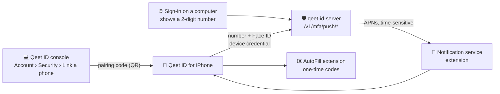

<div align="center">


# 🔐 Qeet ID for iPhone

**Sign-in codes that work offline, and approving Qeet ID sign-ins with Face ID: the native iPhone authenticator, built on Qeetrix for iOS.**

[](#-getting-started)
[](#-getting-started)
[](#-screens)
[](https://github.com/qeetgroup/qeetrix-ios)
[](#-security-model)
[](#-screens)

[📖 Docs](https://docs.id.qeet.in) · [📱 Screens](#-screens) · [🧭 Architecture](docs/llm/architecture-map.md) · [🔒 Security](SECURITY.md) · [📝 Changelog](CHANGELOG.md)

</div>

## 📦 What's inside

| | |
|:--|:--|
| 🔢 **Sign-in codes** | RFC 6238 codes for Qeet ID and any site with 2-step verification, computed on the iPhone with CryptoKit, so they work offline. Add an account by scanning its QR code or typing its setup key |
| ✅ **Sign-in approvals** | Link the iPhone to a Qeet ID account once with a pairing code, then approve each sign-in by typing the 2-digit number from the sign-in screen and confirming with Face ID |
| 🔔 **Time-sensitive requests** | Requests arrive through APNs as time-sensitive notifications; a notification service extension adds the browser and system they come from |
| ⌨️ **AutoFill codes** | On iOS 18 and later, codes appear above the keyboard in Safari and apps; the codes for the site come first, and Face ID comes before any code is filled |
| 🔒 **Face ID lock** | Face ID (or the passcode) each time the app opens, and a privacy cover in the app switcher, so nobody holding your unlocked iPhone can read your codes |
| 🗝️ **Keychain, this device only** | One Keychain item per account, never synced to iCloud and never restored to another iPhone. Qeet ID never receives a code's secret |
| 🎨 **Qeetrix for iOS** | Every screen is built from Qeetrix's components over the system's own navigation bars, search, sheets, alerts and menus, in light and dark |
| ♿ **Accessible** | VoiceOver labels and headings, Dynamic Type to the largest size, right-to-left layouts, Reduce Motion and haptics |

## 📱 Screens

Built to the approved mockup (27 screens in four sections, light and dark).

| Section | Screens |
|:--|:--|
| 👋 **Getting started** | Welcome · Lock with Face ID (step 1 of 2) · Get sign-in requests (step 2 of 2) |
| 🔢 **Sign-in codes** | Accounts, with search, the copied toast and the problems a person can hit · No accounts yet · Scan a QR code · Camera access is off · Type the setup key · Account actions (context menu) · Rename account · Delete, safely |
| ✅ **Sign-in approvals** | Link this iPhone · Scan the pairing code · Name this iPhone · iPhone linked · A request arrives (notification) · Review and type the number · Face ID · Approved · Denied · Request ended |
| ⚙️ **Lock, settings and AutoFill** | Locked · Settings · Unlink this iPhone · AutoFill codes · AutoFill: choose a code |

## 🔗 How it fits



The phone holds a long-lived device credential, so it approves sign-ins without a signed-in session of its own. The
server owns every decision: whether a request is still open, whether the number matches, and what the sign-in gets.

## 🚀 Getting started

**Requirements:** a Mac with Xcode 27.2 or later. Simulator builds need nothing else: no account, no team, no
`.env`.

```sh
git clone https://github.com/qeetgroup/qeet-id-ios.git
cd qeet-id-ios
open QeetID.xcodeproj        # then Product › Run on an iPhone simulator
```

Xcode fetches [Qeetrix for iOS](https://github.com/qeetgroup/qeetrix-ios) through Swift Package Manager the first
time. From the command line:

```sh
xcodebuild build -project QeetID.xcodeproj -scheme QeetID \
  -destination 'platform=iOS Simulator,name=iPhone 17'
```

**The API is production unless you say otherwise.** Every build talks to `https://api.id.qeet.in`. A Debug build
can point at a local [qeet-id-server](https://github.com/qeetgroup/qeet-id-server) with a launch argument, which the
notification extension follows too:

```sh
xcrun simctl launch booted com.qeetgroup.qeetid -api-url http://localhost:4001
```

Release builds ignore the argument. To run on an iPhone, put your team in `Configs/Signing.xcconfig.local`, which git
ignores (see [Configs/Signing.xcconfig](Configs/Signing.xcconfig)).

## 🔌 Server endpoints

| Purpose | Endpoint | Credential |
|:--|:--|:--|
| Link this iPhone | `POST /v1/mfa/push/pairing/claim` | The one-time pairing code |
| Read a sign-in request | `GET /v1/mfa/push/challenges/{id}` | None: it shows no secret, and never the number |
| Approve or deny it | `POST /v1/mfa/push/challenges/{id}/respond` | The device credential, with the typed number |
| Send a new APNs token | `POST /v1/mfa/push/devices/{id}/push-token` | The device credential |
| Unlink this iPhone | `POST /v1/mfa/push/devices/{id}/unlink` | The device credential |

The device credential travels in the JSON body, never in a header, and is never logged.

## 🧱 Project layout

```text
QeetID.xcodeproj       one project, folder-synchronised groups (the files on disk are the source of truth)
Configs/               xcconfig build settings, Info.plists and entitlements for every target
Core/                  app + both extensions: TOTP, Base32, otpauth, Keychain, API client, models
Shared/                app + AutoFill: SwiftUI pieces both draw, Face ID
QeetID/                the app: onboarding, accounts, linking, approvals, lock, settings
AutoFill/              ASCredentialProviderViewController: one-time codes, iOS 18 and later
NotificationService/   UNNotificationServiceExtension: names the browser on a request
QeetIDTests/           unit tests (Swift Testing), hosted in the app for the Keychain
QeetIDUITests/         XCUITests for every flow
```

## 🔨 Building and testing

```sh
# Build and run the unit and UI tests on a simulator: what CI runs
xcodebuild test -project QeetID.xcodeproj -scheme QeetID \
  -destination 'platform=iOS Simulator,name=iPhone 17'

# Format check, with the swift-format that ships in Xcode
xcrun swift-format lint --strict --recursive Core Shared QeetID AutoFill NotificationService QeetIDTests QeetIDUITests
```

Warnings are errors in every target. CI runs on pull requests into `main` and pushes to `main`.

| | |
|:--|:--|
| 🧪 **Unit tests** | 69 Swift Testing tests in 14 suites: RFC 6238 and RFC 4226 vectors, RFC 4648 Base32, `otpauth://` links, pairing codes, the Keychain stores and their accessibility, the API client against `URLProtocol` stubs, and the models behind the screens |
| 🤖 **UI tests** | 29 XCUITests, one or more per flow, against a stub of the API that runs on localhost inside the test runner |
| 🔁 **End to end** | Against a local [qeet-id-server](https://github.com/qeetgroup/qeet-id-server): sign-up, the console's pairing code, link, approve with the number, deny, a wrong number, expiry, unlink, and a simulated push ([workflows](docs/llm/workflows.md)) |

## 🛡️ Security model

- **Secrets stay in the Keychain**, `…ThisDeviceOnly`, in a Keychain access group the app and its AutoFill extension
  share. They are read when a code is computed and never kept in SwiftUI state, a log or a toast.
- **The device credential is a password.** It approves sign-ins for 180 days after the iPhone was last linked, so it
  is stored like a secret, sent only in request bodies, and removed from the server when the iPhone is unlinked.
- **Number matching and Face ID.** Approving needs the 2-digit number from the sign-in screen and a fresh
  `deviceOwnerAuthentication`, whatever the app lock is set to. A borrowed, unlocked iPhone can't approve.
- **Linking always asks first.** A pairing link opened from elsewhere fills in the code; only the person's tap links.
- **No localhost default.** An unconfigured build talks to production; only a Debug build accepts another address.

More in [SECURITY.md](SECURITY.md).

## 📚 Learn more

| | |
|:--|:--|
| 🤖 [AGENTS.md](AGENTS.md) | Rules for anyone, person or agent, changing this repository |
| 🧭 [Architecture map](docs/llm/architecture-map.md) | Where each screen, model and endpoint lives |
| 🧱 [Boundaries](docs/llm/boundaries.md) | What the app owns, and what belongs to the server |
| 🛠️ [Workflows](docs/llm/workflows.md) | Running against a local server, simulating a push, adding a screen |
| 🎨 [Qeetrix for iOS](https://github.com/qeetgroup/qeetrix-ios) | The design system every screen is built from |
| 🤖 [Qeet ID for Android](https://github.com/qeetgroup/qeet-id-android) | The same flows on Android |

---

<div align="center">

Made with 🧡 by Qeet Group · [⬆️ Back to top](#-qeet-id-for-iphone)

</div>
